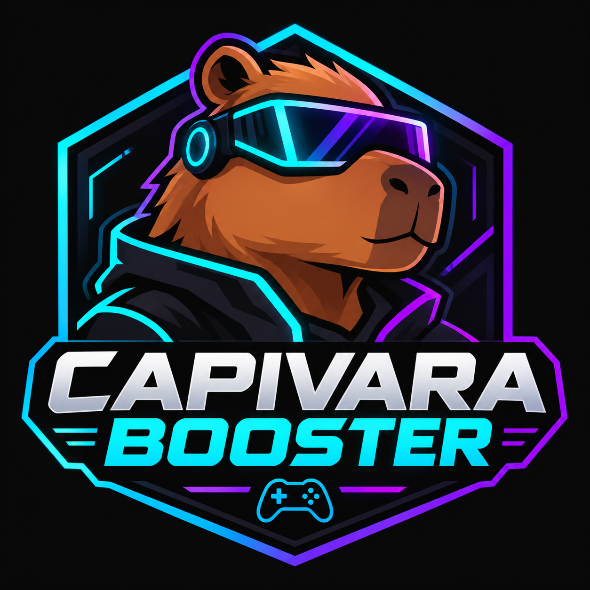

<div align="center">

# 🦫 CAPIVARA BOOSTER

### Suite de Otimização, Debloat e Baixa Latência para Windows 10 & 11

[](https://github.com/victorcatto/Capivara-Booster/releases/latest)
[-9D00FF?style=for-the-badge&logo=windows)](https://github.com/victorcatto/Capivara-Booster)
[](https://github.com/victorcatto/Capivara-Booster)
[](https://github.com/victorcatto/Capivara-Booster)
[](LICENSE)

<br/>



<br/>

[ **🇧🇷 Versão em Português (Brasil)** ](README.pt-BR.md) &nbsp;&bull;&nbsp; [ **🇺🇸 English Version** ](README.md)

---

</div>

<br/>

<!-- ================= CARTÃO DE DOWNLOAD DIRETO PARA USUÁRIOS FINAIS ================= -->

<div align="center">
<table>
<tr>
<td align="center" style="background-color: #141722; border: 2px solid #00E5FF; border-radius: 14px; padding: 24px 32px;">

## ⚡ Download Direto em 1 Clique

### **[ 🚀 BAIXAR O CAPIVARA BOOSTER (INSTALADOR OFICIAL) ](https://github.com/victorcatto/Capivara-Booster/releases/latest/download/CapivaraBooster-Setup.exe)**

**Versão:** `v1.1.0` *(Versão Estável Mais Recente)* &nbsp;|&nbsp; **Arquivo:** `CapivaraBooster-Setup.exe` (~15 MB)  
*Ou veja todas as versões no [GitHub Releases](https://github.com/victorcatto/Capivara-Booster/releases/latest)*

<br/>

> **Guia Rápido em 3 Passos para Usuários Iniciantes:**
> 1. Clique no link **[Baixar](https://github.com/victorcatto/Capivara-Booster/releases/latest/download/CapivaraBooster-Setup.exe)** acima.
> 2. Execute o instalador `CapivaraBooster-Setup.exe` baixado.
> 3. Se o aviso do Windows SmartScreen for exibido (*"O Windows protegeu o seu computador"*), clique em **"Mais informações"** &rarr; **"Executar assim mesmo"** *(isso é normal para utilitários open-source avançados que solicitam privilégios de Administrador para otimizar timers de hardware e o registro do Windows)*.

</td>
</tr>
</table>
</div>

<br/>

---

## 📖 Visão Geral

O **Capivara Booster** é um utilitário desktop para Windows voltado para otimização de sistema, remoção de bloatwares (debloat) e redução extrema de latência, desenvolvido nativamente em **C# (.NET 8 WPF)**. Projetado por engenheiros de sistemas e especialistas em esportes eletrônicos, ele elimina micro-travamentos em segundo plano, limpa gigabytes de caches obsoletos, afina os temporizadores do hardware (HPET) e aplica perfis competitivos para **Counter-Strike 2 (CS2)**, **Valorant** e **League of Legends (LoL)**.

Com uma identidade visual moderna inspirada na estética **Cyberpunk** e no seu logotipo oficial de capivara, o aplicativo conta com alternância dinâmica de idioma em tempo real (**PT-BR / EN-US**), módulo de segurança com ponto de restauração automático e auto-atualizador em segundo plano conectado ao GitHub.

---

## 🎨 Identidade Visual e Estética Cyberpunk

- **Fundo Principal (Grafite Fosco Profundo - `#0F1015`)**: Base elegante e imersiva.
- **Superfície de Painéis (Ardósia Escura - `#181A22`)**: Com bordas sutis iluminadas (`#262A38` e destaque ativo em `#00E5FF`).
- **Destaque Primário (Ciano Neon - `#00E5FF`)**: Botões de ação principais, abas ativas, barras de progresso e alternadores.
- **Destaque Secundário (Roxo Elétrico - `#9D00FF`)**: Efeitos de foco, badges de status e transições gradientes.
- **Tipografia Nítida (`#F4F4F6` e `#8E92A4`)**: Contraste perfeito e descanso visual durante o uso prolongado.
- **Console em Tempo Real Monospaçado**: Terminal embutido com virtualização de interface nativa para renderização fluida a 144Hz.

---

## ⚡ Recursos Principais

### 1. 🧹 Windows Debloater & Privacidade
- **Remoção Segura de Bloatwares UWP**: Remoção com 1 clique de aplicativos pré-instalados (Cortana, Xbox Game Bar, MSN Clima, MSN Notícias, Obter Ajuda, Dicas, Solitaire, Hub de Comentários, Portal de Realidade Misturada, Visualizador 3D) utilizando um pipeline otimizado em lote no PowerShell (~85% mais rápido que desinstaladores sequenciais).
- **Desativação de Telemetria e Diagnósticos**: Desativação dos serviços de rastreamento (`DiagTrack`, `dmwappushservice`, `standardcollector`) e políticas de grupo associadas.
- **Limpeza de Tarefas Agendadas**: Desativa tarefas em segundo plano do Programa de Aperfeiçoamento da Experiência do Usuário (CEIP) e do Compatibility Appraiser.

### 2. 🧼 Limpeza Profunda de Cache, Lixo e Shaders
- **Arquivos Temporários**: Limpeza de `%temp%`, `C:\Windows\Temp` e `C:\Windows\Prefetch`.
- **Cache do Windows Update**: Limpeza segura de `C:\Windows\SoftwareDistribution\Download` com reinicialização garantida do serviço Windows Update (`net start wuauserv`).
- **Lixeira e Limpeza de Rede**: Esvaziamento da Lixeira e limpeza do cache de DNS (`ipconfig /flushdns`).
- **Caches de Shaders de GPU**: Limpeza de caches compilados do DirectX (`D3DSCache`), NVIDIA (DXCache, GLCache, ComputeCache) e AMD Radeon DxCache para eliminar micro-travamentos e conflitos de drivers.
- **Varredura Paralela Assíncrona**: Utiliza threads em segundo plano para calcular tamanhos em milissegundos sem congelar a interface.

### 3. 🚀 Otimizações de Latência e Temporizadores DPC
- **Controle de HPET (High Precision Event Timer)**: Desativação do HPET na inicialização BCD (`bcdedit /deletevalue useplatformclock`, `useplatformtick yes`) e no Gerenciador de Dispositivos (PnP) para reduzir a latência DPC e picos de tempo de quadro (frametime).
- **Plano de Energia Desempenho Máximo**: Desbloqueia e ativa automaticamente o esquema de energia oculto do Windows `Desempenho Máximo` (`e9a42b02-d5df-448d-aa00-03f14749eb61`).
- **Ajustes Globais de Jogos**: Desativação do Game DVR, remoção global de Otimizações de Tela Inteira, desativação de apps em segundo plano, índice de limitação de rede no máximo (`0xFFFFFFFF`) e 100% de prioridade para tarefas de jogos (`SystemResponsiveness = 0`).
- **Gerenciador de Inicialização**: Monitoramento de itens de inicialização em chaves Run de 64-bit, 32-bit (WOW64) e atalhos na pasta Inicializar do usuário.

### 4. 🎮 Módulo de Otimização para Jogos Competitivos

#### 🎯 Counter-Strike 2 (CS2)
- **Prioridade e Afinidade de CPU**: Configura o `cs2.exe` com Prioridade Alta (`CpuPriorityClass = 3`) via IFEO no Registro e omite o Core 0 (`CpuAffinityMask = 0xFFFFFFFE`) para melhor escalonamento de threads.
- **Sinalizadores de Compatibilidade**: Força Reconhecimento de Alto DPI e desativa otimizações de tela inteira em `AppCompatFlags\Layers`.
- **Limpeza de Shaders Steam**: Limpa com segurança o cache de shaders do AppID `730`.
- **Geração de `autoexec.cfg` Competitiva**: Gera arquivo de configuração profissional com binds de jumpthrow desubtick, taxa de rede 128-tick (`786432`), buffer de áudio de baixa latência (`snd_mixahead 0.011`) e suspensão do motor após tick do cliente.
- **Opções de Inicialização Recomendadas**: Cópia com 1 clique de `-high -novid +fps_max 0 -nojoy +exec autoexec.cfg`.

#### 🏹 Valorant
- **Escalonamento de Processos**: Define `VALORANT-Win64-Shipping.exe` em Prioridade Alta enquanto limita o `RiotClientServices.exe` para Prioridade Baixa (Ocioso), impedindo interrupções da CPU durante a partida.
- **Limpeza de Logs e Crash Dumps**: Remove arquivos de log, dumps de travamento e webcache local (`%localappdata%\VALORANT\Saved`).
- **Exclusões do Windows Defender**: Adiciona exclusões para o Riot Vanguard (`vgk.sys`, `vgc.exe`) e pastas de instalação, eliminando a sobrecarga de varredura do antivírus em tempo real.

#### ⚔️ League of Legends
- **Controle do Cliente Chromium**: Aplica automaticamente as configurações `LowSpecMode=1` e `CloseClientDuringGame=1` nos arquivos `game.cfg` e `PersistedSettings.json`, fechando o cliente pesado durante a partida e liberando até 1,5 GB de memória RAM.
- **Limpeza de Logs e Exclusões do Defender**: Remove logs de partidas anteriores e adiciona exclusões no Windows Defender para a pasta Riot Games.

### 5. 🛡️ Segurança, Backup e Restauração
- **Ponto de Restauração do Sistema**: Criação automática de Ponto de Restauração (`Checkpoint-Computer`) antes de executar alterações no registro ou debloating.
- **Backup de Configurações**: Criação de arquivos `.bak` com carimbo de data/hora antes de modificar arquivos de configuração dos jogos.
- **Reversão com 1 Clique**: Repositório imutável para restaurar todos os valores originais do registro do Windows a qualquer momento.

### 6. 🌐 Suporte Bilíngue Completo (i18n — PT-BR & EN-US)
- **Zero Strings Hardcoded**: Todas as legendas, botões, avisos e mensagens de erro são carregadas dinamicamente de dicionários JSON ([pt-BR.json](src/CapivaraBooster/Localization/pt-BR.json) e [en-US.json](src/CapivaraBooster/Localization/en-US.json)).
- **Troca em Tempo Real**: Alterne entre Português e Inglês instantaneamente no cabeçalho superior direito sem fechar ou reiniciar o programa.
- **Auto-Detecção**: Reconhece o idioma do Windows na primeira inicialização e salva as preferências em `%AppData%\CapivaraBooster\settings.json`.

---

## 🔰 Guia Passo a Passo para Iniciantes

### Passo 1: Baixar e Instalar
1. Baixe o instalador **[CapivaraBooster-Setup.exe](https://github.com/victorcatto/Capivara-Booster/releases/latest/download/CapivaraBooster-Setup.exe)** através do botão de download direto acima.
2. Dê um duplo clique no arquivo baixado. Se o Controle de Conta de Usuário (UAC) do Windows solicitar, clique em **Sim** para conceder permissões de Administrador.
3. Siga o assistente de instalação e abra o **Capivara Booster** pelo atalho da Área de Trabalho ou Menu Iniciar.

### Passo 2: Login ou Cadastro de Conta
1. No canto superior direito do aplicativo, clique em **Login / Register**.
2. Para criar sua conta, selecione a aba **Sign Up** e insira seu e-mail e uma senha (mínimo de 6 caracteres).
   > **Aviso sobre Provedores de E-mail Permitidos:**  
   > Por motivos de integridade e segurança, o registro é aceito exclusivamente para:  
   > &bull; `@gmail.com`  
   > &bull; `@outlook.com`  
   > &bull; `@yahoo.com.br`  
   > &bull; `@yahoo.com`  
3. Após o login, sua sessão é salva de forma criptografada pelo Windows DPAPI.

### Passo 3: Criar Ponto de Restauração e Otimizar
1. No **Dashboard**, clique no botão **Quick Boost** para aplicar as otimizações recomendadas de forma automática, ou navegue pelas abas:
   - **Debloat**: Marque os aplicativos inúteis que deseja remover e desative a telemetria.
   - **Cleaner**: Clique em **Escanear**, selecione os caches desejados e clique em **Limpar Selecionados**.
   - **System Boost**: Desative o **HPET**, ative o plano **Desempenho Máximo** e aplique os ajustes de rede.
   - **Game Optimizer**: Detecte seus jogos instalados (CS2, Valorant, LoL) e aplique os perfis competitivos.
2. Se desejar reverter qualquer modificação, acesse a aba **Backup & Restore** e clique em **Reverter Tweaks de Registro** ou restaure os arquivos originais dos jogos.

### Passo 4: Atualizações Automáticas
- O Capivara Booster verifica periodicamente por novas versões em segundo plano. Quando uma atualização for lançada, um aviso azul surgirá no topo da tela. Basta clicar em **Update Now** para que a versão mais recente seja baixada e instalada de maneira automática.

---

## 🛠️ Instruções para Desenvolvedores e Compilação

### Pré-requisitos
- **Windows 10 ou 11 (64-bit)**
- **.NET 8 SDK** (`net8.0-windows`)
- *(Opcional para gerar instalador)*: **Inno Setup 6**

### Compilando a partir do Código-Fonte

```powershell
# Clonar o repositório
git clone https://github.com/victorcatto/Capivara-Booster.git
cd Capivara-Booster

# Restaurar pacotes e dependências
dotnet restore CapivaraBooster.sln

# Compilar em modo Release
dotnet build CapivaraBooster.sln -c Release

# Publicar executável na pasta local
dotnet publish src/CapivaraBooster/CapivaraBooster.csproj -c Release -r win-x64 --self-contained false -o ./publish/app
```

### Script de Lançamento Automatizado (1 Clique)

Para lançar uma nova versão a partir do terminal:
```powershell
# Incrementa a versão, compila, commita, tagueia e envia para acionar o GitHub Actions CI/CD:
.\publish-update.ps1 -BumpType patch -Message "Otimizações de desempenho"
```

---

## 🔒 Segurança e Privacidade

- **Sem Coleta de Dados**: O Capivara Booster roda localmente na sua máquina. Nenhum dado de navegação, telemetria pessoal ou digitação é coletado ou transmitido.
- **Regra de Administrador Único**: O acesso com perfil de Administrador dentro do sistema é exclusivo de `victorcatto93@gmail.com`. Todos os demais cadastros operam como usuários padrão sem privilégios de escalonamento.
- **Armazenamento Criptografado**: Credenciais locais e tokens de sessão são protegidos pelo DPAPI do Windows.
- **Desinstalação Limpa**: O desinstalador oficial remove todos os arquivos da aplicação e reverte entradas criadas.

---

## 📜 Licença

Distribuído sob a licença **MIT**. Veja o arquivo `LICENSE` para mais detalhes.

<div align="center">
<b>Capivara Booster &copy; 2026 &mdash; Desenvolvido com ❤️ para a comunidade gamer competitiva.</b>
</div>